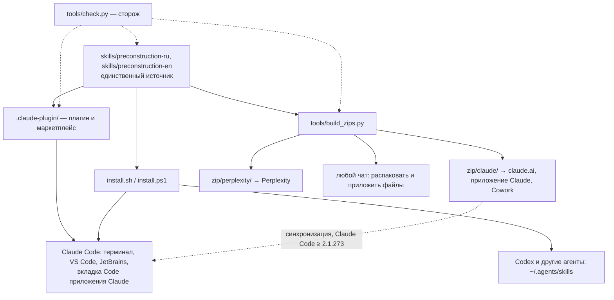

# Разбор: пакет навыков по требованиям Anthropic и установка на разные ОС и устройства

Дата разбора — 2026-11-02. Основание: документация Anthropic на эту дату (ссылки в конце),
уроки vault, образцы `~/NSU-AI-SKILLS` (установщики, сборщик архивов, сторож) и
`~/PROMPT-Professor` (страница навыков, предел описания в байтах). Сценарии —
[USE-CASES.md](USE-CASES.md), отложенное — [BEKLOG.md](BEKLOG.md).

## Сводка

1. Навыки ставятся одним путём — копированием папки в Claude Code. Плагина
   и маркетплейса нет, поэтому `/plugin` не работает ни на одной ОС, а на Windows
   ссылки `.claude/skills/*` клонируются текстовыми файлами.
2. Описание `preconstruction-ru` весит 1036 байт: Perplexity принимает не больше
   1024 байт и такой навык отклонит.
3. Архивов нет. claude.ai ждёт zip с папкой навыка в корне, Perplexity принимал
   zip с `SKILL.md` в корне — это два разных формата.
4. **Несущий разрыв:** навык написан только под Claude Code. В claude.ai, Perplexity
   и других чатах нет инструментов `Agent` и `AskUserQuestion`, и навык не говорит,
   что делать без них. Модель может пропустить аудит и выдать отчёт, который выглядит
   готовым.
5. Навык не самодостаточен: ссылается на `~/PRECONSTRUCTION` и на базу знаний вне
   своей папки; в архиве её нет.
6. Промпты потоков не запрещают порождать подагентов и не требуют назвать, чем
   подтверждено каждое утверждение. Тот же пробел дал урок
   `knowledge/lessons/search-agent-fanout-without-provenance.md` в vault.
7. Ничто не сторожит пакет: ни шапку, ни байты, ни зеркальность RU/EN, ни состав
   архивов. В git лежат пять `.DS_Store`.

Закрываем сейчас пункты 1–7. Откладываем: проверку на телефоне, загрузку через API,
прогон проверок поведения (он платный), выбор лицензии (решение автора).

## Схема: один источник — шесть путей доставки



## Таблица разрывов

| № | Разрыв | Важность | Фаза |
|---|---|---|---|
| 1 | Вне Claude Code навык не знает, как вести потоки, вопросы и отчёт без `Agent`, `AskUserQuestion` и файловой системы; может молча пропустить аудит | несущий | B |
| 2 | Описание `preconstruction-ru` — 1036 байт при пределе Perplexity 1024 | важный | B |
| 3 | Путь `~/PRECONSTRUCTION` в двух `SKILL.md`; критерии «нужен ли ИИ» живут только в базе знаний, вне навыка | важный | B |
| 4 | Потоки без запрета ветвления, без бюджета поиска и без провенанса | важный | B |
| 5 | Нет `.claude-plugin/plugin.json` и `marketplace.json` | важный | C |
| 6 | Нет установщиков; на Windows ссылки-симлинки не работают | важный | D |
| 7 | Нет архивов под claude.ai и Perplexity; собирать мышью нельзя (урок `finder-zip-ships-ignored-files`) | важный | E |
| 8 | Нет сторожа: разрывы 2, 3 и 7 вернутся незаметно | важный | E |
| 9 | Нет проверок поведения навыка (лучшие практики Anthropic требуют не меньше трёх) | терпит | F |
| 10 | README и STUDENT-SETUP описывают только старый путь; ссылки в базах знаний идут через симлинки; `.DS_Store` в git; нет `.gitattributes` | важный | G |

## Метрика «до»

Путей установки, описанных в документах и годных к работе: **1 из 6** (Claude Code
ручным копированием). Цель — 6 из 6: плагин Claude Code, установщик для macOS, Linux
и Windows, архив для claude.ai, архив для Perplexity, файлы для любого чата, каталог
`~/.agents/skills` для других агентов.

Замеры, из которых сложены пункты сводки:

```bash
# описание в байтах: RU 1036, EN 639
python3 -c "import re;t=open('skills/preconstruction-ru/SKILL.md').read();d=re.search(r'description: >-\n((?:  .*\n)+)',t).group(1);print(len(' '.join(l.strip() for l in d.splitlines()).encode()))"
grep -rn "~/PRECONSTRUCTION" skills | wc -l                       # 2
grep -rn -E 'AskUserQuestion|`Agent`|deep-research' skills/*/SKILL.md skills/*/references/*.md | wc -l   # 18
git ls-files | grep -c DS_Store                                   # 5
```

## Решения

**Р-1. Плагин — весь репозиторий, `source: "./"`.** Навыки уже лежат в `skills/`,
а это место по умолчанию для навыков плагина. Отдельная папка `plugins/preconstruction/`
сдвинула бы канонический путь, на который ссылаются QR-код, STUDENT-SETUP и, возможно,
слайды в PDF. Цена — в кэш плагина копируется весь репозиторий, включая два PDF
(около 9 МБ). Отвергнуто: подпапка плагина и ссылки из неё на `skills/` — пути
компонентов плагина не могут выходить за его корень.

**Р-2. В шапке `SKILL.md` — только поля спецификации.** claude.ai, Skills API
и `package_skill.py` принимают `name`, `description`, `license`, `compatibility`,
`metadata`, `allowed-tools`; любое другое поле — жёсткая ошибка загрузки. Поэтому
`when_to_use` не используем, а описание укладываем в 1024 **байта** (строже предела
Anthropic в 1024 знака) — так одна шапка годится для Claude Code, claude.ai, API,
Perplexity и агентов по стандарту agentskills.io. Отвергнуто: подменять шапку
при сборке архива — тогда архив и репозиторий расходятся.

**Р-3. Два вида архива.** `zip/claude/` — папка навыка в корне (требование справки
claude.ai: «The ZIP should contain the skill folder as its root»), `zip/perplexity/` —
`SKILL.md` в корне (формат, принятый Perplexity при проверке автором 19.09.2026).
Принимает ли Perplexity первый формат, не проверено, поэтому один архив на всех
не делаем.

**Р-4. Навык ведёт себя по среде, а не по инструментам.** В Claude Code потоки идут
параллельно через `Agent`; где этого инструмента нет — по очереди, каждый своим
разделом, а аудит — отдельным проходом. Ни одна фаза не пропускается ни в одной
среде.

**Р-5. Навык самодостаточен.** Всё, что нужно агенту, лежит в папке навыка:
критерии «нужен ли ИИ внутри» вынесены в `references/ai-necessity-criteria.md`.
База знаний остаётся учебником для людей и навыку не нужна.

**Р-6. Установщик по умолчанию ставит ссылки, по ключу — копии.** Ссылки обновляются
через `git pull` (образец — `~/NSU-AI-SKILLS`). Копии — для тех, кто скачал zip
и потом удалит папку. На Windows — junction: не требует прав администратора
и режима разработчика.

**Р-7. Версия — в трёх местах, сторож сверяет.** `plugin.json` (`version` держит
пользователей плагина на этой версии, пока её не поднимут) и `metadata.version`
обоих `SKILL.md` (по ней видно версию у того, кто взял архив).

## Чего не делаем сейчас

| Что | Почему |
|---|---|
| проверка на телефоне | справка Anthropic не описывает навыки в мобильных приложениях; проверить может только автор на своём телефоне — бэклог, п. 1 |
| загрузка через Skills API | для разработчиков, а не для слушателей курса; нужен ключ API — бэклог, п. 2 |
| прогон `claude plugin eval` | расходует лимиты автора; проверки написаны, запуск — решение автора — бэклог, п. 3 |
| лицензия | выбор автора — **закрыто 2026-11-02**: тексты CC BY 4.0, код MIT; бэклог, п. 4 |
| вынос PDF из репозитория | слайды могут ссылаться на файлы по пути; вес плагина пока терпим — бэклог, п. 5 |
| подача в каталог Anthropic | сначала обкатка на курсе — бэклог, п. 6 |

## Закрыто

Было — стало — чем подтверждается. Фазы A–G вошли в коммит `1a65501` «обновление навыка 2»
(`.DS_Store` сняты с учёта в `99c337a`); лицензия — отдельным коммитом поверх них.
Все замеры — 2026-11-02.

### Разрыв 1 (несущий) — навык вне Claude Code

- **Было:** потоки только через `Agent`, вопросы только через `AskUserQuestion`, отчёт только
  файлом; что делать без них — не сказано.
- **Стало (фаза B):** таблица «Среда определяет способ, а не состав работы» в обоих `SKILL.md`:
  все четыре фазы обязательны везде; без `Agent` потоки идут по очереди своими разделами,
  аудит — отдельным проходом; вопросы — текстом; отчёт — файлом или ответом; без веб-поиска
  все цифры — `[гипотеза]`. Чек-лист фаз копируется в ответ.
- **Закрыто:** текстом навыка; поведение в claude.ai и Perplexity не прогонялось — проверяется
  загрузкой (СЦ-04, СЦ-05).

### Разрывы 2–4 — шапка, самодостаточность, потоки

- **Было:** описание RU 1036 байт; `~/PRECONSTRUCTION` в двух местах; критерии ИИ вне навыка;
  потоки без запрета ветвления и провенанса.
- **Стало (фаза B):** описание RU — 482 знака / 842 байта, EN — 554 / 554; шапка — только
  `name`, `description`, `metadata`; новый справочник `references/ai-necessity-criteria.md`;
  в `research-roles.md` — блок «Ограничения работы», пометки провенанса и оглавление.
- **Закрыто:** `python3 tools/check.py` — «Расхождений нет.»; валидатор Anthropic
  `quick_validate.py` (навык skill-creator) на распакованных `zip/claude/*.zip` —
  «Skill is valid!» для обоих навыков.

### Разрыв 5 — плагин и маркетплейс

- **Было:** установка только копированием папки.
- **Стало (фаза C):** `.claude-plugin/plugin.json` (`preconstruction` 1.1.0)
  и `.claude-plugin/marketplace.json` (`preconstruction-skills`, `source: "./"`).
- **Закрыто:** `claude plugin validate .` (Claude Code 2.1.314) — «Validation passed»;
  установка в изолированный каталог настроек: `CLAUDE_CONFIG_DIR=<временный> claude plugin
  marketplace add <репозиторий>` → `claude plugin install preconstruction@preconstruction-skills`
  → `claude plugin details preconstruction`: «Skills (2) preconstruction-en, preconstruction-ru»,
  постоянная цена около 277 токенов, при вызове около 1,8 тыс. на навык. Для подачи в каталог
  Anthropic валидатор требует лицензию и иконку — бэклог, пп. 4 и 6.

### Разрыв 6 — установщики

- **Было:** ручное копирование; на Windows симлинки клонируются текстом.
- **Стало (фаза D):** `install.sh` (ссылки, `--copy`, `--uninstall`) и `install.ps1`
  (junction, `-Copy`, `-Uninstall`, только ASCII).
- **Закрыто:** `install.sh` прогнан с `HOME` во временной папке в шести режимах: ссылки
  в оба каталога; чужая папка с тем же именем пропущена и не тронута; повторный запуск
  ничего не меняет; `--uninstall` снимает только свои ссылки; `--copy` копирует;
  неизвестный ключ — код 2. `install.ps1` не исполнялся — бэклог, п. 7; ASCII сторожится
  `tools/check.py`.

### Разрывы 7–8 — архивы и сторож

- **Было:** архивов нет; проверок нет.
- **Стало (фаза E):** `tools/build_zips.py` → `zip/claude/` и `zip/perplexity/`, по 10 файлов
  в архиве; `tools/check.py` — девять групп проверок, правила отбора файлов общие со сборщиком.
- **Закрыто:** повторная сборка без правок даёт байт в байт те же архивы (`shasum -c`);
  на копии репозитория сторож роняет прогон на каждой из подложенных ошибок: старая шапка
  из git, поле `when_to_use`, описание 1194 байт, правка справочника без пересборки, PDF
  в навыке, ссылка за пределы навыка.

### Разрыв 9 — проверки поведения

- **Стало (фаза F):** три случая в `evals/`: навык срабатывает на естественную фразу
  по-русски и по-английски и начинает со скоупинга; на чужой запрос не срабатывает.
- **Не закрыто:** ни разу не запущены — прогон платный, бэклог, п. 3. Режима «только проверить
  файлы случаев» у `claude plugin eval` нет.

### Разрыв 10 — документы и гигиена

- **Стало (фаза G):** README и STUDENT-SETUP — шесть путей установки; `skills/README.md`,
  `research/README.md`, `zip/README.md`, `CHANGELOG.md`, `AGENTS.md`; ссылки баз знаний ведут
  на `skills/`, а не через симлинки; `.gitignore`, `.gitattributes`; пять `.DS_Store` сняты
  с учёта git (`git rm --cached`, сами файлы на диске остались).
- **Закрыто:** `tools/check.py` — ссылки в документах ведут на существующие файлы, ни одна
  не идёт через `.claude/skills`, в git нет служебных файлов ОС.

**Метрика «после»:** описано и годно к работе 6 путей установки из 6; проверены исполнением
три — плагин, `install.sh`, архивы claude.ai (валидатором Anthropic). Загрузка в claude.ai
и Perplexity и запуск на Windows — за автором.

## Источники

- Навыки в Claude Code: https://code.claude.com/docs/en/skills
- Обзор Agent Skills: https://platform.claude.com/docs/en/agents-and-tools/agent-skills/overview
- Лучшие практики: https://platform.claude.com/docs/en/agents-and-tools/agent-skills/best-practices
- Манифест плагина: https://code.claude.com/docs/en/plugins-reference
- Маркетплейс: https://code.claude.com/docs/en/plugin-marketplaces
- Установка плагинов: https://code.claude.com/docs/en/plugins/install.md
- Проверки поведения: https://code.claude.com/docs/en/plugin-evals.md
- Навыки в claude.ai: https://support.claude.com/en/articles/12512180-using-skills-in-claude
- Свой навык для claude.ai: https://support.claude.com/en/articles/12512198-creating-custom-skills
- Стандарт: https://agentskills.io/specification
